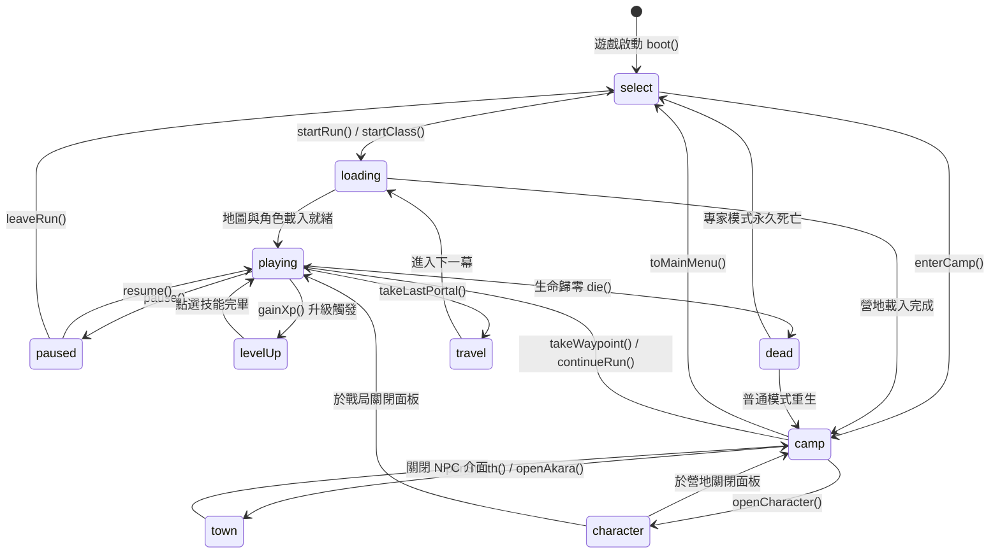

# 遊戲核心系統反編譯分析 (game-core.md)

本文件分析 D2 Survivors (build 20261101.1) 核心運行架構，包含 \`Game\` 類別生命週期、狀態機、\`tick\` 流程與存檔資料結構。所有位置偏移以原始 \`gamejs2/Game-CP0n0PpN.js\`（記作 \`G新\`）及相關檔案之 0 起算 UTF-16 字元索引為準。

---

## 1. Game 類別與架構總覽

在前端代碼中，主遊戲控制器為類別 \`nN\`（匯出別名為 \`Game\`，定義於 \`G新:261673\` 至 \`G新:393607\`）。

### 類別方法分類清單

\`Game\` 類別包含 326 個方法與內部輔助常式，依功能分類如下：

| 分類 | 代表方法 (原名) | 推測語意與職責 |
|---|---|---|
| **啟動與重設** | \`constructor\` (265664), \`boot\` (273382), \`reset\` (302611), \`runHost\` (271920) | 初始化 Pixi Canvas、音效、HUD、事件監聽器，建立全新運行環境 |
| **選角與選單** | \`toMenu\` (273678), \`chooseClass\` (296905), \`plainSelect\` (297159), \`showMenu\` (388860) | 主選單跳轉、原生暗黑風格選角或純文字選角介面 |
| **營地系統** | \`layCamp\` (274725), \`leaveCamp\` (278349), \`updateCamp\` (278953), \`campWalls\` (280812), \`clickCamp\` (281035) | 營地物件生成、碰撞邊界、NPC 走動與點擊互動 |
| **城鎮與 NPC** | \`talkInCamp\` (283416), \`openKashya\` (286159), \`openHireList\` (286714), \`openAkara\` (289323), \`openSmith\` (357897), \`showTown\` (358940) | 卡夏僱傭兵管理、阿卡拉藥水與洗點、恰西鐵匠裝備購買與強化 |
| **戰局流程** | \`startRun\` (298558), \`continueRun\` (299881), \`newWorld\` (305329), \`leaveRun\` (390641), \`saveAndExit\` (389748) | 關卡生成、載入、中途接關、存檔並返回主選單 |
| **主循環與控制** | \`tick\` (310228), \`steer\` (312130), \`update\` (313637), \`render\` (329946), \`layout\` (311740) | 固定時基物理模擬、玩家輸入方向向量計算、Pixi 繪圖調用 |
| **戰鬥與死亡** | \`onLifeGone\` (339235), \`die\` (339631), \`dieForGood\` (340862), \`bossFell\` (341991), \`winRun\` (346981) | 生命耗盡判定、復活、專家模式永久死亡、通關擊殺統計 |
| **裝備與儲物** | \`equippedOf\` (309171), \`inventoryOf\` (309226), \`ownGear\` (367382), \`wearable\` (372299), \`swapIn\` (372694), \`moveCharm\` (373442) | 角色紙娃娃裝備替換、護符放置、空間與職業需求驗證 |
| **藥水與腰帶** | \`drinkFrom\` (382713), \`fitBelt\` (382966) | 依腰帶欄位消耗藥水，套用治療、魔力或活力效果 |
| **任務與獎勵** | \`useQuest\` (374440), \`readCodex\` (377697), \`readBook\` (378117), \`openTome\` (378548), \`readTome\` (378789) | 赫拉迪克法典、技能書、城鎮傳送之書等任務道具使用 |
| **恐懼與天梯** | \`enterTier\` (350288), \`startTerror\` (349537), \`tierVictory\` (352586), \`openLeaderboard\` (285015) | 恐懼層挑戰開啟、層數通關推進、天梯數據上傳檢查 |
| **數值與存檔** | \`heroNumbers\` (386619), \`previewGear\` (387152), \`checkpointRun\` (388084), \`reloadIntoRun\` (388234) | 屬性面板動態統計（防禦、抗性、減傷）、戰局進度快照存檔 |

---

## 2. 狀態機 (State Machine) 規格

遊戲透過 \`this.state\` 管理整體介面與執行流程。所有可能狀態共 10 種：

| 狀態名稱 | 代表意涵 | 主要進入途徑 | 允許的轉移目標 |
|---|---|---|---|
| \`select\` | 英雄角色選擇主選單 | 啟動完成 (\`boot\`)、離開營地 (\`toMainMenu\`)、放棄接關 | \`loading\`, \`camp\`, \`playing\` |
| \`loading\` | 資產與地圖載入中 | 開始新戰局 (\`startRun\`)、切換幕／難度 | \`playing\`, \`camp\`, \`select\` (失敗退回) |
| \`camp\` | 營地閒置中 | 主選單進入營地、戰局通關返回營地 | \`town\`, \`character\`, \`select\`, \`playing\` |
| \`town\` | 城鎮 NPC 互動介面 (商店/鐵匠/商人) | 點擊營地 NPC、商人開箱、點擊傳送點 | \`camp\`, \`travel\` |
| \`character\` | 角色紙娃娃裝備與屬性面板開啟 | 點擊角色頭像、點擊裝備快捷鍵 (\`openCharacter\`) | \`camp\`, \`playing\` |
| \`playing\` | 戰鬥中 (核心主循環執行中) | 載入完成進入地圖、點擊繼續戰鬥 | \`paused\`, \`levelUp\`, \`dead\`, \`town\`, \`travel\`, \`camp\` |
| \`paused\` | 戰局暫停中 (選單開啟) | 玩家按下 Esc / 暫停鈕 (\`pause\`) | \`playing\`, \`select\` (離開戰局) |
| \`levelUp\` | 升級選技能介面開啟 | 經驗值達標觸發 (\`offerLevelUp\`) | \`playing\` |
| \`dead\` | 角色陣亡過場 | 玩家生命值歸零 (\`onLifeGone\` → \`die\`) | \`select\` (回主選單), \`camp\` (普通模式復活) |
| \`travel\` | 幕間傳送或傳送門過場動畫中 | 進入紅門、擊敗巴爾傳送門 (\`takeLastPortal\`) | \`loading\`, \`camp\`, \`playing\` |

### 狀態轉移動態圖



---

## 3. Tick 主循環流程 (\`tick\`)

\`Game.prototype.tick\` 定義於 \`G新:310228\`，每幀由瀏覽器 \`requestAnimationFrame\` 或 Pixi ticker 調用：

### 還原虛擬碼

```typescript
/*@310228*/
function tick(frameTime: number): void {
  // 1. 世界存在性防禦檢查
  if (!this.world) return;

  // 2. 顯示懸停與佈局調整
  if (this.displayHeld) this.holdQuietly();
  this.layout(); // 更新畫布比例與視口半寬高 (halfW, halfH)

  // 3. 手把技能選取超時判定
  if (this.padPicked && performance.now() > this.padPicked.until) {
    this.padPicked = null;
    this.hud.pickSkill(null);
  }

  // 4. 版本更新與新手提示橫幅判定
  if (this.updateNotice && this.state === 'playing') {
    this.hud.banner(`Build ${this.updateNotice} is ready to install from the main menu`, 'rare', { key: 'update', ms: 8000 });
    this.updateNotice = null;
  }
  if (this.freshStartNotice && this.state === 'playing' && this.world.time >= 1) {
    this.hud.banner(this.freshStartNotice, 'normal', { key: 'fresh-start', ms: 10000 });
    this.freshStartNotice = null;
  }

  // 5. 時間步長步數計算 (固定模擬頻率 hi: steps & dt)
  let { steps: stepCount, dt } = hi(frameTime);
  let uiOpen = this.hud.skillsOpen || this.hud.questLogOpen;
  if (uiOpen && !this.skillsWereOpen) {
    this.input.release();
  }
  this.skillsWereOpen = uiOpen;

  // 6. 核心戰鬥步進 (僅在 state === 'playing' 且無阻擋介面時運行)
  let canPlay = (this.state === 'playing') && this.strayPlay();
  for (let s = 0; s < A.speed * stepCount && canPlay && this.state === 'playing' && !uiOpen; s++) {
    this.update(dt); // 實體移動、AI 行為、碰撞、彈道更新
  }

  // 7. 營地步進 (僅在 state === 'camp' 時運行)
  for (let s = 0; s < stepCount && this.state === 'camp'; s++) {
    this.updateCamp(dt);
  }

  // 8. 面板展示動態與死亡時間累計
  if (this.state === 'character') be(this.world, dt * stepCount);
  if (this.deathTime !== null) this.deathTime += dt * stepCount;

  // 9. 畫面渲染調用
  this.frameGuard.run('render', () => this.render());

  // 10. 戰局進度定時自動儲存 (Checkpoint)
  if (this.state === 'playing' && this.purse.running && !this.offRecord) {
    B('run checkpoint', () => this.runSaver.tick(frameTime));
  }
}
```

---

## 4. 存檔資料結構 (\`this.save\`)

存檔物件根節點欄位規格如下（定義於 \`keepSave-DxUL_UG-.js\` 及 \`G新:343301\` 快照生成）：

| 欄位名稱 | 形態 | 職責與內容說明 |
|---|---|---|
| \`heroes\` | \`Record<string, HeroProfile>\` | 各職業專屬資料。鍵為職業名稱（如 \`amazon\`, \`sorceress\`）。內含 \`kept\`（永久保留裝備快照）、\`run\`（當前戰局中狀態） |
| \`kept\` | \`KeptState\` | 角色當前紙娃娃持有裝備與屬性快照：\`{ doll, build, tree, attributes }\` |
| \`continue\` | \`ContinueInfo \| null\` | 中途接關資料：記錄關卡 \`act\`、難度 \`difficulty\`、時間 \`time\`、種子 \`seed\` |
| \`unlocked\` | \`Record<string, boolean>\` | 已解鎖功能字典（如各難度通關、恐懼層解鎖、特定職業解鎖） |
| \`baalSlain\` | \`boolean\` | 是否已擊敗過地獄難度巴爾（解鎖毀滅符石或額外成就判定） |
| \`stashTabs\` | \`Record<string, Item[]>\` | 儲物箱頁簽物品陣列。含 \`personal\`（個人欄）及共用頁簽 |
| \`ranks\` | \`Record<string, number>\` | 恰西強化等級表（基礎普通 rank，最大上限受 \`maxRank\` 限制） |
| \`extraRanks\` | \`Record<string, number>\` | 支援無上限（endless）特性的額外 rank 等級表（0..999） |
| \`gold\` | \`number\` | 玩家金幣總儲備（上限受 \`1e10\` 驗證限制） |
| \`light\` | \`{ wings: boolean, shards: number, worn: any }\` | 泰瑞爾之翼與碎片進度（10 碎片合成整副翅膀） |
| \`retired\` | \`Record<string, RetiredRun[]>\` | 退役或通關存檔封存記錄（天梯與歷史成績驗證來源） |

---

## 5. 常數表 (Constants Table)

| 常數名 | 所在檔案:位置 | 數值 | 語意說明 |
|---|---|---|---|
| \`A.speed\` | \`G新:185719\` | \`1.0\` (預設) | 全域戰鬥時基倍率（調速或快進倍率） |
| \`A.terror\` | \`G新:273456\` | \`number \| null\` | 啟動時指定之恐懼層層數參數 |
| \`qC\` | \`I新:371452\` | \`-100\` | 屬性抗性與防禦折減下限 (-100%) |
| \`1e10\` | \`S新:39505\` | \`10,000,000,000\` | 存檔金幣上限合法性臨界值 (100 億) |
